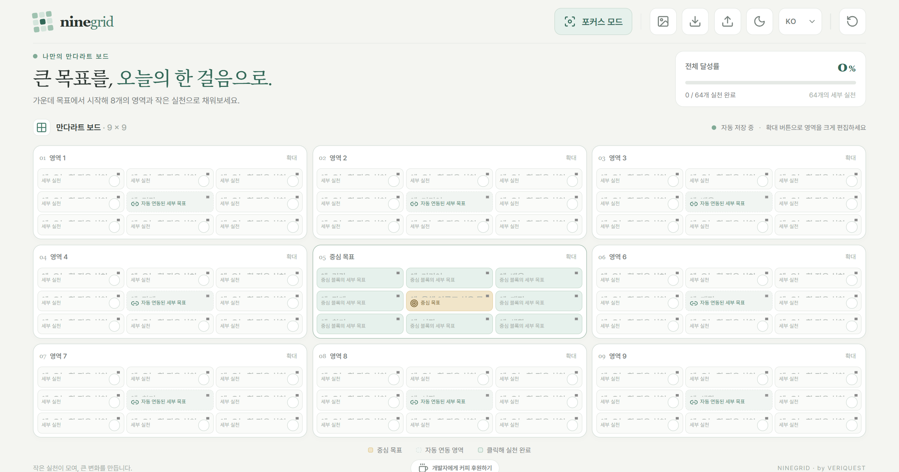

# NineGrid

태블릿과 PC에 맞춘 9×9 만다라트 목표 관리 앱입니다. 중심 목표의 주변 8개 영역은 바깥 블록의 제목 칸과 자동으로 연결되며, 64개의 세부 실천을 체크해 달성률을 확인할 수 있습니다.



**바로 사용하기:** https://ninegrid.veriquest.workers.dev/

## 주요 기능

- **81칸 자동 연동**: 중앙 블록의 8개 영역을 입력하면 대응하는 바깥 블록의 제목 칸에 자동으로 반영됩니다.
- **포커스 모드**: 블록 하나만 크게 띄워 편집하고, 이전/다음 버튼이나 목록으로 블록을 이동합니다.
- **달성률 체크**: 내용을 작성한 실천 칸만 체크할 수 있고, 달성률(%)은 작성한 칸 대비 완료한 칸으로 계산됩니다.
- **이미지 저장**: 보드를 PNG로 저장합니다. 모바일·태블릿에서는 공유 시트를 사용하고, 지원하지 않으면 파일로 내려받습니다. 포커스 모드에서는 보고 있는 블록만 저장됩니다.
- **인쇄 / PDF 저장**: A4 가로 한 장에 전체 보드를 인쇄합니다. 내용과 완료 체크(☑/☐)를 함께 인쇄하는 **현재 보드**와, 칸만 인쇄해 손으로 채우는 **빈 양식** 중에서 고를 수 있습니다. 인쇄 창에서 대상을 "PDF로 저장"으로 고르면 PDF 파일이 됩니다.
- **JSON 백업/복원**: 보드를 파일로 내보내고 다시 불러올 수 있습니다.
- **예시 보드**: 건강·학습·커리어 예시를 불러와 구조를 살펴보고, 그대로 고쳐서 내 보드로 쓸 수 있습니다.
- **앱 설치와 오프라인 실행**: 홈 화면이나 PC에 앱처럼 설치할 수 있고, 한 번 연 뒤에는 인터넷 연결 없이도 열고 편집할 수 있습니다. 새 버전이 배포되면 상단에 안내가 뜨고, **새로고침**을 눌러야 적용됩니다.
- **라이트/다크 테마**와 **4개 언어**(한국어, 영어, 일본어, 중국어 간체)를 지원합니다. 첫 방문에는 브라우저 언어를 따릅니다.

## 사용 방법

1. 처음이라 막막하다면 빈 보드 위의 **샘플 보기**나 상단의 **예시 보드** 버튼으로 예시를 불러와 보세요. 선택한 언어로 된 건강·학습·커리어 예시 중 하나를 고를 수 있고, 일부 실천은 완료 표시가 되어 있어 달성률이 어떻게 보이는지 확인할 수 있습니다. 불러오면 지금 보드를 덮어쓰므로 확인 창이 먼저 뜨고, 백업하지 않은 변경이 있으면 백업을 권합니다. 불러온 뒤에도 **실행 취소**로 이전 보드로 돌아갈 수 있습니다.
2. 중앙 블록에 최종 목표를 적고, 그 주변 8칸에 핵심 영역을 입력합니다.
3. 각 영역 이름이 바깥 8개 블록의 제목 칸에 자동으로 들어갑니다. 블록마다 8개씩 세부 실천을 채웁니다.
4. 블록의 **확대**를 누르거나 상단의 **포커스 모드**를 켜면 한 블록씩 집중해서 편집할 수 있습니다.
5. 실천을 마치면 칸의 체크 버튼을 눌러 달성률을 올립니다.
6. 상단의 **인쇄 / PDF 저장** 버튼으로 보드를 종이나 PDF로 뽑을 수 있습니다. 다크 테마나 포커스 모드여도 항상 밝은 배경의 전체 보드가 인쇄되고, 긴 글은 칸에 맞춰 글자 크기가 줄어듭니다. 인쇄가 지원되지 않는 기기에서는 이미지 저장을 이용하세요.
7. 상단 버튼으로 이미지 저장, 백업·복원, 테마·언어 변경, 보드 초기화를 할 수 있습니다. **빈 보드로 초기화**는 모든 칸을 비우고, **예시 보드**는 내용이 채워진 예시로 바꿉니다.
   - 휴대폰처럼 폭이 좁은 화면(760px 이하)에서는 이미지 저장, 인쇄 / PDF 저장, 백업·복원, 앱으로 설치, 예시 보드, 초기화 버튼이 오른쪽 위 **더보기**(⋯) 메뉴 안에 들어갑니다. 백업하지 않은 변경이 있으면 더보기 버튼에도 점이 표시됩니다.

## 데이터 저장

보드, 테마, 언어는 서버로 전송되지 않고 **사용 중인 브라우저의 localStorage에만** 자동 저장됩니다. 브라우저 데이터를 지우거나 다른 기기·브라우저에서 열면 보드가 보이지 않으므로, 중요한 내용은 JSON 백업으로 보관하세요.

- 처음 접속하면 "이 브라우저에만 저장된다"는 안내가 한 번 표시됩니다.
- 마지막 백업 이후 보드를 수정하면 백업 버튼에 점이 표시되고, 백업하지 않은 변경이 있는 채로 7일이 지나면 백업 알림 배너가 나타납니다. 배너에서 바로 백업하거나, 7일 뒤로 미루거나, 다시 보지 않도록 끌 수 있습니다.
- 앱으로 설치한 경우 일부 환경(특히 iOS의 홈 화면 앱)에서는 설치한 앱과 브라우저가 저장 공간을 따로 씁니다. 브라우저에서 쓰던 보드가 설치한 앱에 보이지 않으면, 브라우저에서 JSON 백업을 내려받아 설치한 앱에서 복원하세요.
- 알림 상태는 보드와 별도로 `ninegrid-backup-meta-v1` 키에 저장되며, JSON 백업 파일에는 포함되지 않습니다.

## 앱 설치 (PWA)

- **Android·PC (Chrome, Edge)**: 설치할 수 있는 상태가 되면 상단에 **앱으로 설치** 버튼이 나타납니다. 브라우저 주소창의 설치 아이콘이나 메뉴에서도 설치할 수 있습니다.
- **iPhone·iPad (Safari)**: 공유 버튼 → **홈 화면에 추가**를 누릅니다. iOS는 설치 버튼을 지원하지 않아 상단 버튼은 나타나지 않습니다.
- 오프라인 캐시에는 앱 화면을 구성하는 정적 파일만 저장합니다. 보드 데이터는 지금처럼 localStorage에만 저장됩니다.
- 새 버전은 자동으로 새로고침되지 않습니다. 업데이트 안내에서 **새로고침**을 누르면 적용되며, 보드 내용은 그대로 남습니다. 실행 취소 기록은 새로고침하면 지워집니다.
- 아이콘은 `public/favicon.svg`로 만듭니다. 아이콘을 바꾸면 `npm run generate-pwa-assets`로 다시 만드세요.

## 기술 스택

React 19 · TypeScript · Vite · vite-plugin-pwa · Tailwind CSS 4 · lucide-react · html-to-image · oxlint · Vitest

## 개발

```bash
npm install
npm run dev       # 개발 서버
npm run build     # 타입 검사 + 프로덕션 빌드
npm run lint      # oxlint
npm run test      # 단위 테스트 (Vitest)
npm run preview   # 빌드 결과 미리보기
```

## 폴더 구조

```text
index.html  메타 태그(OG 등)와 앱 진입 HTML
src/
  main.tsx    앱 진입점
  App.tsx     보드 UI와 상태 관리
  board.ts    보드 규칙 (연동, 체크, 달성률, 백업 검증)
  board.test.ts  board.ts 단위 테스트
  samples.ts  예시 보드 데이터 (4개 언어, JSON 백업 형식)
  samples.test.ts  예시 보드 검증 테스트
  print.ts    인쇄용 보드 데이터 (칸 종류, 체크 표시, 글자 크기 단계)
  print.test.ts  print.ts 단위 테스트
  pwa.ts      PWA (Service Worker 등록, 업데이트 안내, 설치 버튼)
  i18n.ts     다국어 문구
  App.css     스타일
public/       파비콘, PWA 아이콘, 공유 미리보기 이미지(og.png)
```